<!-- Profile README · Mohammad Adib Watfa · colors: #07111F bg · #2ED8FF cyan · #8C7CFF violet (matches the portfolio site) -->

<div align="center">


<a href="https://github.com/adibwatfa341-alt">
  
</a>

<p>
  <a href="https://www.linkedin.com/in/mohammad-adib-watfa"></a>
  <a href="mailto:adibwatfa341@gmail.com"></a>
  <a href="https://adibwatfa341-alt.github.io/Adib_CV/"></a>
</p>

</div>

### ⚡ Recruiter quick scan

<div align="center">

| 🎯 Role | 🧑‍💻 Experience | 🛠️ Core stack | 🌍 Location |
|:---:|:---:|:---:|:---:|
| AI Engineer<br/><sub>Document AI · Computer Vision · GenAI</sub> | **AI Engineer at Metamas**<br/><sub>Apr 2025 → now</sub> | Python · FastAPI · Celery · Redis<br/><sub>Vision LLMs · PyTorch · SAM 3 · OpenCV</sub> | Aleppo, Syria · UTC+3<br/><sub>Arabic & English</sub> |

<sub><b>Keywords:</b> AI Engineer · Document AI · Intelligent Document Processing · Vision LLMs · Computer Vision · Anomaly Detection · RAG · FastAPI · Celery · Redis · PyTorch · AI-Native Development · MCP</sub>

</div>

---

### 👋 About me

I build **AI services that keep working in production**, not only in a demo.

- 🏭 **Now:** AI Engineer at **Metamas**, building Document AI pipelines with Vision LLMs and zero-shot anomaly detection for industrial parts.
- 🧱 **Background:** Python backend engineering, so I treat an AI feature as a full product: async workers, validated outputs, retries, monitoring, tests and deployment.
- 🤖 **How I work:** AI-native. Claude Code, Claude Cowork, custom agent skills and MCP connectors handle exploration and boilerplate; design, review and the quality bar stay mine.
- 🌍 Aleppo, Syria · Arabic (native) & English

### 📊 Impact in numbers

<div align="center">

| <h2>15% → 80%</h2> | <h2>27% → 0%</h2> | <h2>15x</h2> | <h2>200</h2> | <h2>93%</h2> |
|:---:|:---:|:---:|:---:|:---:|
| defect recall<br/><sub>after calibration</sub> | false alarms<br/><sub>on known-good parts</sub> | document types supported<br/><sub>1 → 15 work-order types</sub> | students screened<br/><sub>on a platform I built</sub> | of questions auto-scored<br/><sub>28 of 30</sub> |

</div>

---

### 🚀 Featured work

<sub>Built at Metamas. The code is private; the descriptions and numbers are mine. Click a project to expand it.</sub>

<details open>
<summary><b>📄 Enterprise Document Intelligence & Data Extraction</b> · founder of the service</summary>
<br/>

Turns utility work-order PDFs of up to **94 pages** into structured, typed JSON with a Vision LLM.

`FastAPI` `Celery` `Redis` `Gemini VLM` `OpenCV` `PyMuPDF` `Pydantic` `Flower` `Docker`

- 📚 Spec-driven field catalog, grown from **1 to 15 work-order types** and **60+ fields**
- 🧭 OpenCV header-template page routing with **zero LLM calls**; GIS maps and attachments are skipped
- 🔁 Exponential-backoff retries, per-page progress streaming and Flower monitoring
- 🧾 Constrained **JSON-schema** outputs, deterministic normalization and cross-field validation rules

```mermaid
flowchart LR
    C["Client"] -->|"PDF + type"| A["FastAPI"]
    A -->|enqueue| R[("Redis")]
    R --> W["Celery worker"]
    W --> P["Render pages · PyMuPDF"]
    P --> O["Classify pages · OpenCV<br/>0 LLM calls"]
    O --> L["Extract fields · Vision LLM<br/>JSON schema"]
    L --> N["Normalize + cross-field rules"]
    N --> S[("Structured result")]
    W -.->|progress per page| R
    C -->|poll status| A
```



</details>

<details>
<summary><b>🔍 Zero-Shot Industrial Anomaly Detection</b> · AnomalyCLIP + SAM 3 on NVIDIA DGX</summary>
<br/>

Turned the **AnomalyCLIP** research model (ICLR 2024) into a production service that finds defects without defect training examples.

`PyTorch` `AnomalyCLIP` `SAM 3` `FastAPI` `Celery` `React` `TypeScript` `PostgreSQL` `Alembic` `Docker`

- 🎯 Calibration raised defect recall from **15% to 80%** and cut false alarms from **27% to 0%**
- ✂️ SAM 3 region segmentation scores each part separately, so small defects are not averaged away
- 🖥️ Deployed on an **NVIDIA DGX Spark (ARM64)**; 18 REST endpoints and **74 automated tests**

</details>

<details>
<summary><b>📝 Talent Assessment Platform</b> · used to screen 200 university students</summary>
<br/>

Arabic (RTL) online assessment, scored automatically across 5 traits.

`FastAPI` `React` `SQLite` `Docker` `Nginx`

- ✅ Auto-scores **28 of 30** questions (93%)
- ⏱️ Server-signed 30-minute timer, answer shuffling and duplicate checks
- 📤 Excel export in the original scoring template, plus automatic backups

</details>

<details>
<summary><b>🧾 Multimodal AI PDF-to-Markdown Service</b> · Gemma · Arabic & English</summary>
<br/>

Converts PDF pages into clean Markdown with a multimodal LLM, through background jobs.

`FastAPI` `Celery` `Redis` `PyMuPDF` `Gemma` `Google GenAI`

- 🚦 Redis rate limiter (atomic Lua script) that keeps **every worker** under a 10 requests/minute quota
- 🔁 Exponential-backoff retries with jitter, per-page progress and task-status APIs
- 🔌 Pluggable LLM provider interface and 20 tests

</details>

<details>
<summary><b>🤖 AI-Native Development</b> · how I ship</summary>
<br/>

`Claude Code` `Claude Cowork` `Agent Skills & Plugins` `MCP Connectors` `n8n`

| Stage | What AI agents do | What stays mine |
|---|---|---|
| Explore | Read the codebase, trace data flow, map impact | Decide the design and the trade-offs |
| Build | Scaffold routes, models, tests and docs | Domain logic and boundaries |
| Review | Propose fixes and refactors | Review every diff |
| Test | Generate test cases and diagnostic scripts | Decide what "correct" means |

</details>

---

### 🔬 Engineering case studies

<sub>Real problems from my work, described without confidential details.</sub>

<details>
<summary><b>🎚️ Why a fixed 0.5 threshold failed, and what replaced it</b> · anomaly detection · statistics</summary>
<br/>

**Problem:** after cropping parts out of a multi-object frame, a frame of perfectly good parts scored **0.89**, "defective" under any fixed 0.5 rule.

**Approach:** score 20+ known-good parts per part type through the same crop policy, and set the threshold at `median + k · 1.4826 · MAD`. That bound stays stable even if one bad part slips into the "good" set. Every profile is stamped with a hash of the crop policy, so thresholds are never compared across policies.

**Result (30 good + 20 defective parts):**

| k | Recall | False alarms |
|:---:|:---:|:---:|
| 1.0 | 19/20 | 8/30 |
| **2.0** | **16/20** | **0/30** |
| 3.0 | 3/20 | 0/30 |

The textbook k = 3 looked safe but caught only 15% of defects; k = 2 caught 80% with no false alarms.

</details>

<details>
<summary><b>🚦 One rate limit, many workers</b> · Redis · Lua · Celery</summary>
<br/>

**Problem:** the model API allows a fixed number of requests per minute, but several Celery workers process pages in parallel. Per-worker limits still exceed the shared quota.

**Approach:** one shared slot counter in Redis, reserved through an **atomic Lua script**, so every worker waits for its own slot. Temporary failures retry with exponential backoff and jitter instead of failing the whole document.

</details>

<details>
<summary><b>🖥️ Deploying PyTorch on an ARM64 GPU box</b> · NVIDIA DGX Spark · Docker</summary>
<br/>

**Problem:** the common CUDA base images have no ARM64 build, so a full Docker image failed with `exec format error`.

**Approach:** a hybrid setup. Postgres and Redis run in containers (multi-arch), while the model runs on the machine's native, GPU-enabled PyTorch. A setup script checks the architecture, GPU access, port conflicts and cached weights, then prints the exact commands for the mode that works.

</details>

---

### 🧰 Tech stack

<div align="center">


</div>

<details>
<summary><b>See the full stack by area</b></summary>
<br/>

| Area | Tools |
|---|---|
| **AI & LLMs** | Multimodal LLMs, Vision LLMs, Gemini API, Gemma, Hugging Face, Ollama, structured outputs, prompt engineering, RAG |
| **Computer Vision** | PyTorch, CLIP / ViT, AnomalyCLIP, SAM 3, OpenCV, image segmentation, OCR |
| **Documents** | PyMuPDF, PDF processing, page classification, PDF-to-Markdown |
| **Backend** | Python, FastAPI, Django REST Framework, Pydantic, SQLAlchemy, Alembic |
| **Async & Data** | Celery, Redis, Flower, PostgreSQL, MongoDB, SQLite |
| **DevOps** | Docker, Docker Compose, Nginx, GitHub Actions, NVIDIA DGX |
| **Testing** | pytest, unit and API tests, test doubles |
| **AI-native tools** | Claude Code, Claude Cowork, agent skills & plugins, MCP connectors, n8n |

</details>

---

### 🎓 Education

<div align="center">

| 🎓 **B.Sc. Computer Systems Engineering** · Cordoba Private University · 2020 – 2025 | 🏆 Competitive programming · ICPC-related events |
|:---:|:---:|

</div>

### 💭 How I think

```python
class Adib(AIEngineer):
    mission = "Build AI that keeps working after the demo ends."

    principles = [
        "A model is a feature; the product is everything around it.",
        "Validate every output. Retry every transient failure.",
        "Measure before you trust a threshold.",
        "AI agents speed me up. Judgment stays human.",
    ]

    def on_new_problem(self) -> str:
        return "Let's ship it, and test it."
```

---

<div align="center">

### 🤝 Let's connect

Interested in **AI engineering**, **Document AI** and **computer vision** roles

<a href="https://www.linkedin.com/in/mohammad-adib-watfa"></a>
<a href="mailto:adibwatfa341@gmail.com"></a>
<a href="https://adibwatfa341-alt.github.io/Adib_CV/"></a>


</div>
